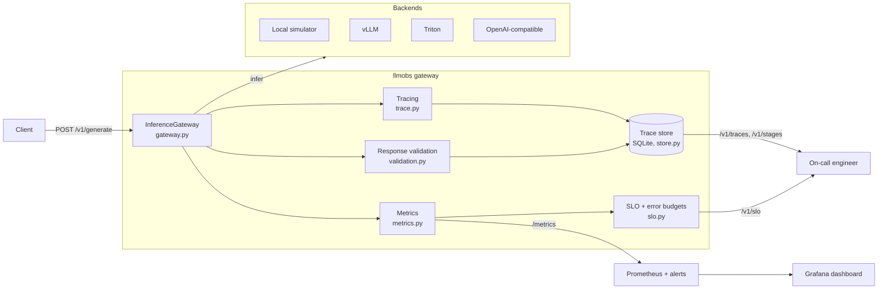
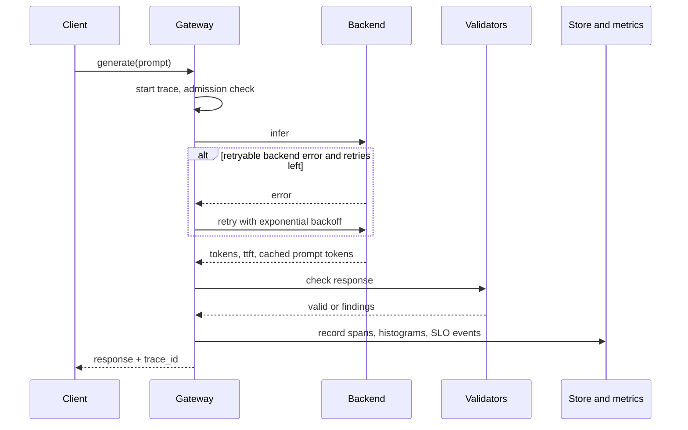

# Architecture and use cases

## System overview

The gateway wraps every inference call. A request is traced into spans, sent to
a backend, checked by response validators, and recorded to the trace store,
metrics and SLO tracker. Prometheus and Grafana read the metrics, and an
on-call engineer reads the trace store.

## One request

## Components

| Module | Responsibility |
|---|---|
| `gateway.py` | `InferenceGateway`: `generate`, `stream`, load shedding, retries of retryable backend errors, health refresh |
| `trace.py` | Spans, traces, sampling and exclusive-time attribution per stage |
| `validation.py` | Quality checks such as valid JSON and not truncated |
| `metrics.py` | Counters, gauges and histograms with Prometheus exposition |
| `slo.py` | Objectives, error budgets, multi-window burn rate |
| `store.py` | SQLite trace store with on-call queries |
| `loadgen.py` | Concurrent traffic generator for load tests |
| `server.py` | FastAPI service: `/health`, `/ready`, `/metrics`, `/stats`, `/v1/generate`, `/v1/traces`, `/v1/stages`, `/v1/slo` |
| `backends/` | Local simulator, vLLM, Triton and OpenAI-compatible adapters |
| `deploy/` | Prometheus config and alerts, Grafana dashboard, Kubernetes manifests |

## Use cases

| Use case | Who | How it helps |
|---|---|---|
| See where latency actually goes | ML platform engineer | Per-stage breakdown (request, inference, retry, validation) with exclusive time |
| Investigate one slow or bad request | On-call engineer | Look up a trace by `trace_id`, and list the slowest requests with reasons |
| Alert on user-visible degradation | SRE | Multi-window burn-rate SLOs for availability, p95 latency and time-to-first-token |
| Catch quality regressions, not just outages | Product or ML owner | Response validation flags truncation and invalid JSON |
| Confirm prefix caching is paying off | Inference engineer | Cached prompt tokens and hit rate appear in the metrics |
| Capacity-test before launch | Performance engineer | `llmobs load` drives concurrent traffic with retries, queueing and failure injection |
| Put one monitoring layer over several serving stacks | Platform team | Backends normalise health across vLLM, Triton and OpenAI-compatible servers |
| Ship a metrics endpoint to existing observability | DevOps | `/metrics` is valid Prometheus exposition, with a Grafana dashboard and alert rules in `deploy/` |
| Develop and test with no GPU | Any developer | The local simulator needs no model or hardware |
